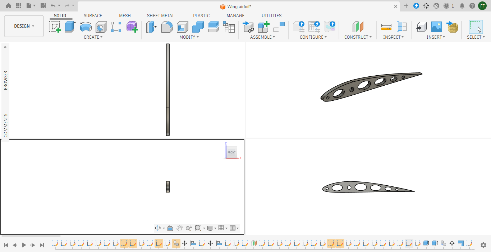

# NACA 4412 Airfoil Rib

A 3D CAD design of a lightweight wing rib based on the *NACA 4412 airfoil profile, developed using **Autodesk Fusion 360* for a fixed-wing Unmanned Aerial Vehicle (UAV).

🔍 *[View the 3D Model in Your Browser](naca-4412-airfoil-rib.stl)*

---

## 📌 Overview

This project focuses on the design and development of wing ribs for a fixed-wing UAV wing structure.

The rib geometry is based on the *NACA 4412 airfoil profile*, featuring a cambered aerodynamic shape with a maximum camber of 4% and a maximum thickness of 12% of the chord length.

The design incorporates structural openings for spar integration and aims to balance structural considerations, weight efficiency, and compatibility with FDM 3D printing.

The ribs are intended to form part of a modular wing structure with an approximate half-span of 600 mm per side.

### About the NACA 4412 Airfoil

The NACA 4412 is a four-digit airfoil profile:

- *4* – Maximum camber of 4% of the chord.
- *4* – Maximum camber position at 40% of the chord.
- *12* – Maximum thickness of 12% of the chord.

For a nominal chord length of approximately 150 mm:

- Maximum camber: approximately 6 mm.
- Maximum camber position: approximately 60 mm from the leading edge.
- Maximum theoretical thickness: approximately 18 mm.
- Maximum thickness position: approximately 45 mm from the leading edge.

---

## 📐 Specifications

| Parameter | Value |
|---|---|
| Component | Wing Rib |
| Airfoil Profile | NACA 4412 |
| Actual Chord Length | ~149.925 mm |
| Actual Profile Height | ~18.200 mm |
| Root Rib Thickness | 5 mm |
| Intermediate Rib Thickness | 4 mm |
| Tip Rib Thickness | 3 mm |
| Structural Features | Spar mounting openings |
| CAD Software | Autodesk Fusion 360 |
| Material | PLA (planned) |
| Manufacturing Method | FDM 3D Printing |
| Application | Fixed-Wing UAV |
| Planned Half-Wing Span | ~600 mm |
| Planned Total Wingspan | ~1200 mm |

---

## ⚙️ Design Process

The design process involves developing the airfoil geometry, constructing the rib structure, and preparing the model for manufacturing.

### 1. Airfoil Geometry

The initial geometry is based on the NACA 4412 airfoil profile. The airfoil shape is established in Autodesk Fusion 360 while maintaining its aerodynamic proportions.

### 2. Scaling and Dimensioning

The airfoil geometry is scaled to an actual chord length of approximately 149.925 mm, resulting in a profile height of approximately 18.200 mm.

### 3. Rib Construction

The airfoil profile is developed into a solid rib structure with thicknesses adapted to different wing positions:

- 5 mm for the root rib.
- 4 mm for intermediate ribs.
- 3 mm for tip ribs.

This approach is intended to accommodate the structural requirements of different sections of the wing.

### 4. Spar Integration

Dedicated openings are incorporated into the rib geometry at the forward, central, and rear positions to accommodate the wing's structural spar arrangement.

These openings are intended to maintain alignment between individual ribs and the longitudinal wing structure.

### 5. CAD Refinement and Export

The rib geometry is refined in Fusion 360 and exported into STL format for subsequent slicing and FDM 3D printing.

### Challenges & What I Learned

- Understanding and applying NACA 4412 airfoil geometry.
- Constructing aerodynamic profiles in Autodesk Fusion 360.
- Maintaining geometric proportions during scaling.
- Designing structural openings for spar integration.
- Balancing structural requirements and material efficiency.
- Preparing 3D CAD models for additive manufacturing.

---

## 📁 Files

| File | Description |
|---|---|
| [model/naca-4412-airfoil-rib.stl](naca-4412-airfoil-rib.stl) | STL mesh of the root rib (5 mm) for 3D printing and visualization |
| [images/preview.png](preview.png) | Main CAD model preview |

<!-- Kalau file di bawah ini udah di-upload ke folder yang sesuai, hapus tanda komentar ini biar barisnya muncul di tabel:
| [model/naca-4412-airfoil-rib.step](model/naca-4412-airfoil-rib.step) | STEP file for CAD interoperability |
| [model/naca-4412-airfoil-rib.f3d](model/naca-4412-airfoil-rib.f3d) | Original Autodesk Fusion 360 project |
| [images/technical-drawing.png](images/technical-drawing.png) | Technical drawing and dimensions |
-->

---

## 🖨️ Print Settings

*Manufacturing Status: Not printed yet.*

The following manufacturing parameters will be documented after the first physical prototype is produced.

| Setting | Value |
|---|---|
| Printer | Not specified |
| Material | PLA (planned) |
| Layer Height | Not tested |
| Infill | Not tested |
| Wall Count | Not tested |
| Supports | Not determined |
| Print Time | Not available |
| Printed Weight | Not available |

---

## 🚧 Status & Next Steps

- [x] NACA 4412 airfoil geometry established.
- [x] Rib geometry modeled in Fusion 360.
- [x] Structural spar openings incorporated.
- [x] Rib geometry prepared for 3D printing.
- [x] STL model exported.
- [ ] Evaluate structural strength and weight.
- [ ] Manufacture the first physical prototype.
- [ ] Measure and document printed rib weight.
- [ ] Verify spar fit and alignment.
- [ ] Integrate ribs with the wing spars and outer skin.
- [ ] Complete the full fixed-wing UAV wing assembly.

---

## 📚 Project Context

This project is part of an ongoing fixed-wing UAV development initiative focused on aerodynamic design, structural engineering, and additive manufacturing.

The development process explores the practical integration of aerodynamic geometry, CAD modeling, and 3D printing in small-scale UAV construction.

---

Designed and developed using Autodesk Fusion 360.
